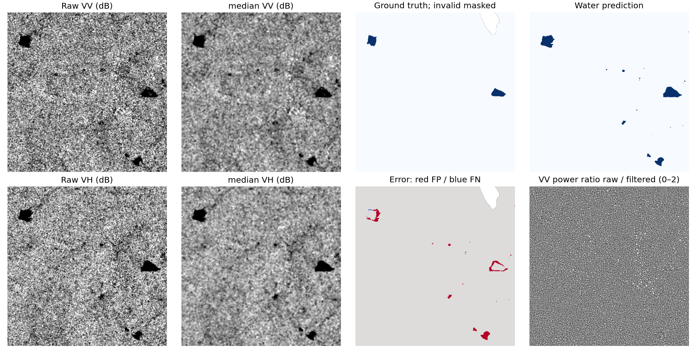
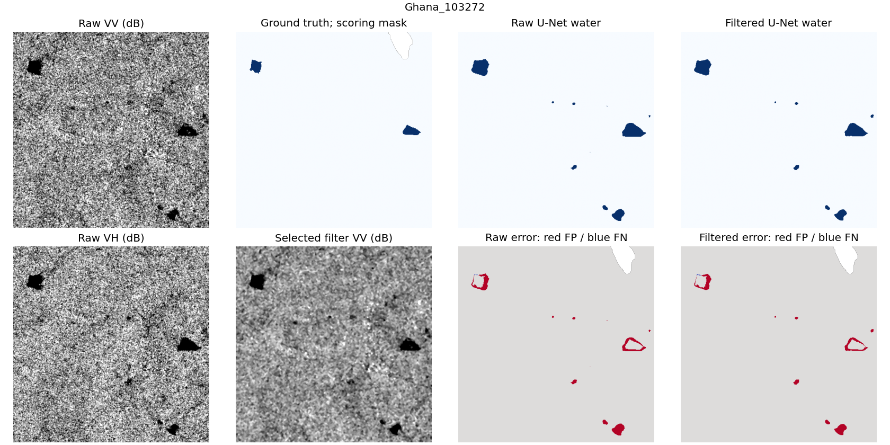

# SAR speckle filtering and surface-water mapping

Development results and supplied execution status, 29 October 2026. Supplied
data/profile and calibration gates are independently accepted. The supplied
scratch GPU pair is also accepted. Held-out measurements and cached notebook integration are independently accepted, closing S1.
Fresh uncached classical Colab is independently accepted at **566.40 seconds**, including setup, dependency restart and all 200 downloads. PR #1 is merged to `main`; the submission is pinned by `v1.0-hackathon`. See the [original-artifact review](colab_execution_review.md).

**Submission warning:** the subsequently supplied recipe defines the first
100 ordered rows of the official training CSV. That is a different set from
the earlier development tables retained later in this report. The primary
supplied tables below now have their own recorded measurements. Its acquisition, raster audit,
frozen internal event split, ROIs and executable source profile have now been
reviewed. Do not submit the development tables as supplied-set measurements.
See the [recipe audit](supplied_subset_recipe.md), [data review](supplied_data_review.md)
and [profile review](supplied_profile_review.md).

## Question and data

Does reducing multiplicative SAR speckle improve water segmentation enough to
justify added computation and loss of detail? We compare four fixed processing
families on two-band Sentinel-1 VV/VH patches, and separately train one compact
U-Net architecture on raw versus validation-selected filtered inputs.

Before receiving the supplied recipe, we selected exactly 100 upstream
Sen1Floods11 v1.1 hand-labeled pairs by label-blind hash ranking within official
train/validation/test partitions: 60/20/20 patches, each 512 by 512 pixels. All
200 object lengths, upstream MD5s and local SHA-256s were verified. Weak/Otsu
labels are excluded. Independent SAR and label validity masks control scoring;
valid zero dB is preserved. One training patch has no scored pixels and another
has only 484; neither was replaced after inspecting labels.

Seven touching cross-partition chip pairs and events shared between partitions
make this a **correlated official-subset development evaluation**. There is no
held-out-event or unseen-geography generalization claim. See the
[data review](development_data_review.md) for exact identities and limitations.

## Supplied-first100 execution status

All 100 supplied pairs have been acquired and audited separately. Each SAR is
two-band VV/VH float32, 512 by 512, declared power dB; independent manual labels
use -1/0/1. The existing seed-42 event rule was frozen before object access:
Mekong/Nigeria/Pakistan train (29), India validation (40), Ghana test (31).
Group isolation takes precedence over exact patch proportions. No cross-split
overlap or touching chips was found; 20 touching pairs remain within partitions.

Exactly 22 identifiers were previously used in development training: five
current train, nine validation and eight test. New U-Nets must start from
scratch. This internal event holdout does not erase prior project exposure or
establish a pristine blind, representative global benchmark. Recipe sender
authority is not independently authenticated.

The test partition has 4,940,307 scored pixels. `Ghana_26376` has no scored
pixels and stays in membership with explicit no-score status; `Ghana_24858`
has only 484. Neither is replaced. Four separately inspected 32 by 32 training
ROIs support effective looks estimation. Five frozen test-only rectangles
support visually homogeneous **land-only** ENL diagnostics, with no water-region
ENL promised. Their class tags are visual SAR interpretation, not independent
ground-truth annotation. They never enter training looks or normalization.

The [source configuration](supplied_source-v1.json) binds the exact
source/selection/acquisition/inventory/audit/split identities. The one notebook
now defaults to `supplied-first100`, preserves the earlier development option,
and checks those source bindings before calibration and held-out access.

Actual calibration completed 98 candidates on the 40 India validation patches,
without opening test files. Its [frozen configuration](../configs/supplied-calibrated-v1.json)
records VH below -20 dB shared by all four families, Median 5, Lee 5 and
bilateral window 5/spatial sigma 2/color sigma 3 dB; Median 5 is selected for
the scratch neural comparison. Train-ROI looks are approximately 4.6020 VV and
2.5820 VH. The calibration took 260.46 seconds on the local Windows CPU; that
excludes acquisition, remote training, held-out evaluation and full notebook
setup/export. The [independent calibration review](supplied_calibration_review.md)
accepted the frozen choices and verified zero held-out access. These are
validation choices, not held-out water scores. See the
[calibration record](supplied_calibration-v1/validation.json).

The supplied raw/Median-5 scratch GPU pair is independently accepted as
described below. Classical/synthetic and neural held-out measurements are now
recorded and independently accepted; cached notebook execution/review are also accepted, closing S1. The development sections later in this report
retain the earlier development experiment unchanged. Exact commands and frozen
metadata restoration are in the [reproduction guide](../docs/REPRODUCING.md).

## Supplied scratch training

The [independent completed-pair review](supplied_training_review.md) accepts
the new seed-42 raw/Median-5 pair from clean source
`0cdb7874e3699cd1e6c0f68a98b5eea6c6e9ff50`. Both conditions start from the
same fresh initialization and use the locked 487,857-parameter VV/VH U-Net,
shared raw-training normalization and matched crop plans for shared epochs.
No earlier development checkpoint was loaded. All 80 native validation
confusion matrices were independently reproduced exactly, with no held-out
source reads. Different early stopping times produce different actual updates.

| Supplied training input | Executed epochs / updates | Best validation epoch | Best validation water IoU |
| --- | --- | ---: | ---: |
| Raw VV/VH | 10 / 150 | 5 | 0.3831 |
| Median-5 VV/VH | 9 / 135 | 4 | 0.3707 |

The complete pair took **76.77 seconds**, including 11.10 seconds of input
preparation, on the dedicated RTX 4000 Ada. Peak CUDA allocation was
964,296,704 bytes; CPU peak RSS was not measured. The hour cap was not exhausted.
These are remote training and validation measurements, separate from held-out
inference and fresh Colab. The worse filtered validation result is retained.

Public [training metadata](supplied_training-v1/summary.json) and the
[original environment](supplied_training-v1/training-environment.txt) retain
the exact configuration, source/data identities, crop records and checkpoint
hashes. The reviewed local checkpoint ZIP is 3,666,469 bytes, SHA-256
`9605d1906802434d73d5ef73239e127395779a03df11596004c94e4acb5aa6d6`.
It has no public release yet. The frozen held-out measurements below are
recorded separately and accepted by the [result review](supplied_results_review.md).

## Supplied held-out results

**Accepted by the [independent result review](supplied_results_review.md).** The frozen
31-patch Ghana membership contributes 4,940,307 scored pixels. All six rows use
the same 15 ground-truth-water-positive macro IDs, 15 dry patches and one
no-score member (`Ghana_26376`). Predictions never change those sets. Classical
rows use shared VH below -20 dB with cleanup off; both U-Nets use strict
probability above 0.5. Neural rows are segmentation models and receive no ENL
or denoising PSNR.

| Supplied held-out method | Water IoU | Water F1 | Precision | Recall |
| --- | ---: | ---: | ---: | ---: |
| Raw + shared threshold | 0.2772 | 0.4341 | 0.3187 | 0.6802 |
| Median 5 + shared threshold | 0.4135 | 0.5851 | 0.5138 | 0.6794 |
| Lee 5 + shared threshold | 0.4051 | 0.5766 | 0.5319 | 0.6295 |
| Log-bilateral + shared threshold | 0.3825 | 0.5534 | 0.4677 | 0.6775 |
| Compact U-Net, raw VV/VH | 0.4208 | 0.5923 | 0.4847 | 0.7614 |
| Compact U-Net, Median-5 VV/VH | 0.4043 | 0.5758 | 0.4707 | 0.7411 |

The [classical table](supplied_classical-v1/results_real.csv) and
[neural table](supplied_neural-v1/results_neural.csv) retain exact counts,
macro/dry summaries and timing scopes. The accepted
[machine checks](supplied_result_checks-v1.json) recount all 186 primary
per-patch rows and 62 native neural masks, along with shared validity, ENL and
synthetic arithmetic. Median raises threshold pooled IoU from
0.2772 to 0.4135. Raw U-Net pooled IoU is 0.4208; Median preprocessing lowers
the paired U-Net result to 0.4043. The filtered model produces 11,487 false
positive pixels on dry patches versus 3,877 for the raw U-Net. These single-seed,
one-event held-out measurements do not establish statistical superiority or
justify a new method search.

Raw thresholding produces 39,098 false-positive pixels over 2,066,885 valid dry
pixels (1.8916%); Median reduces this to 1,727 (0.0836%). Dry-patch counts and
false-positive rates are reported independently of the fixed water-positive
macro mean. The zero-score member is neither a perfect prediction nor an
artificial dry patch.

The predeclared [cleanup ablation](supplied_classical-v1/cleanup_ablation.csv)
changes raw pooled IoU from 0.2772 to 0.3903 and Median from 0.4135 to 0.4175.
It remains separate from the primary comparison. No selected filter, threshold,
model, checkpoint or epoch was revised after test scoring.

## Supplied ENL, synthetic PSNR and runtime

Five fixed visually homogeneous land ROIs per band have finite ENL for every
classical method, with zero undefined regions. Median ENL across the five land
regions is:

| Input | VV land ENL | VH land ENL |
| --- | ---: | ---: |
| Raw | 5.17 | 5.67 |
| Median 5 | 19.01 | 19.83 |
| Lee 5 | 21.00 | 22.79 |
| Log-bilateral | 12.75 | 13.47 |

These are [land-region diagnostics](supplied_classical-v1/enl_summary.csv),
not independent land-class annotations or water-region ENL. Lee has the largest
ENL here while Median has higher threshold water IoU. Smoothness alone therefore
does not establish more faithful mapping.

The fifth region, `supplied_enl_05` in `Ghana_168875`, has 1,024 valid SAR
pixels but no valid label pixels. Its land tag is visual interpretation only;
the other four regions are fully manual-label land. ENL correctly uses the
SAR-validity mask rather than the scoring mask. All five preselected regions
remain shared across methods; none was dropped or replaced after scoring.

The separate [synthetic table](supplied_classical-v1/results_synthetic.csv)
repeats the frozen known-reference procedural benchmark with shared Gamma
corruptions. Three held-out phantoms times three seeds give nine measurements
per method/looks; synthetic validation selects its own fixed settings.

| Looks | Raw PSNR, dB | Median | Lee | Log-bilateral |
| --- | ---: | ---: | ---: | ---: |
| 1 | 3.55 | 12.28 | 18.13 | 7.18 |
| 4 | 9.53 | 19.39 | 22.39 | 16.17 |

Synthetic Lee uses window 7, independently of real-data Lee 5. The explicit
power range is 1.0 and corrupted observations are not clipped. Real noisy SAR
is never a clean reference. These repeated procedural results do not establish
a new real-data advantage or supply independent geographic samples.

The [classical runtime record](supplied_classical-v1/runtime.json) is **59.38
seconds** on the remote Linux CPU, including real scoring/diagnostics, 124
figures and synthetic evaluation. It excludes installation, acquisition,
calibration and the final metadata writes after the recorded clock. The
[neural checkpoint evaluation](supplied_neural-v1/runtime_neural.json) is
**9.06 seconds** on the RTX 4000 Ada, including preflight, native inference,
mask exports/checksums and figures, but excluding final JSON/configuration
serialization. The earlier **76.77-second** training pair is a separate
measurement. No subtotal is a full notebook or fresh Colab runtime.

## Supplied representative behavior

The following figures use the lexicographically first held-out ID,
`Ghana_103272`, rather than a patch chosen by its score. Thresholding and both
U-Nets expand visible pond boundaries relative to supplied masks and retain
isolated dark detections scored as false positives. A dark SAR target alone
does not establish a label error. Median suppresses speckle and softens texture;
its power ratio and error mask remain useful diagnostics alongside ENL. The
[visual record](supplied_visual_review-v1.json) retains figure hashes and these
limited observations. No new setting was selected from this inspection.

## Supplied cached notebook integration

The [independent notebook review](supplied_notebook_review.md) accepts all ten
code cells from source pin `9aef5d3b499ca49bcba5fc3c732238c2fa3ba55f`, closing
S1. The authoritative [smoke summary](supplied_notebook_smoke_summary.json)
records **123.04392588 seconds** from the first executable cell through the
sole final ZIP write and checksum. There were zero cell errors; **96 checks
passed in 8.30 seconds**. The full classical profile includes measured pip
calls, cached access checks, audit, validation, held-out/synthetic evaluation,
124 figures, display and final export. Neural training was disabled.

This was a separate fresh kernel in an existing clean isolated Linux clone,
with **200 cached source TIFFs** and preinstalled kernel prerequisites. Initial
cloning/cache preparation were outside the notebook clock; the environment
was not fresh. The original acquisition log's 44 cache copies/156 downloads
describes historical acquisition, not a new network download in this smoke.

All 98 validation scientific summaries, four held-out classical confusion
counts and 124 per-patch records reproduce the accepted experiment. The fixed
macro/dry/no-score sets, cleanup, 40 ENL records and 72 synthetic test rows also
match. Tiny radiometry roundoff, at most approximately `2.561e-10` absolute,
changes neither choices nor counts. Different run-local manifest/source/config
hashes reflect different relative paths and were independently rebound and
verified before scoring.

The original local ZIP is 164,908,503 bytes, SHA-256
`968b9065b9ded3fb0c3c472e10e4fccf60c12a1f10c5f82481698de841577cef`,
with its authoritative timing sidecar outside the archive. Both remain outside
Git. This accepts cached Linux integration. The subsequent fresh Colab run at source `3eecc1434991835e576e7d3d09d967fbd9388359` completed in **566.397461905 seconds**, including one dependency restart and its wait, zero cached TIFFs and 200 downloads. Its original 164,922,319-byte ZIP has SHA-256 `1e365165f95de72e623a7dd99b1078a97912d0cd99bc24a5bffa570ffc1c29e9`; the authoritative sidecar and ZIP remain outside Git. The [independent review](colab_execution_review.md) closes S2 using retained metadata/results plus browser-observed execution. The unedited sidecar keeps its default unverified attestation; freshness is established by the documented external observation and acquisition evidence. PR #1 subsequently merged the accepted implementation to `main`; `v1.0-hackathon` pins the submission.

## Development methods and selection

Convert power dB with `I = 10**(dB/10)`. Median and multiplicative local-LMMSE Lee
operate on power; bilateral filtering operates in dB and returns power. All
methods process VV/VH independently, fill missing SAR from the nearest valid SAR
pixel, reflect at borders and restore invalid locations. Label validity never
controls inference-time filling.

Six inspected homogeneous training ROIs produce effective looks 4.8593 for VV
and 4.0208 for VH, frozen before validation. These are approximate effective
noise estimates rather than independently measured physical looks. Bounded
validation evaluates 98 candidates. Each common channel/rule selects one
setting per family, then the mean of four pooled validation IoUs selects the
common rule. The frozen rule is **VV below -18 dB**, with Median window 5, Lee
window 5 and bilateral window 5/spatial sigma 2/color sigma 3 dB. Cleanup is
disabled in the primary comparison. Median 5 is the selected neural input.

Independent GPT-6.1 Sol xhigh review reproduced all 98 candidate records and four
cleanup records without opening held-out sources. Calibration version 1 had an
inconsistent ROI byte hash and is superseded; version 2 is accepted. A later
source-identity portability repair preserves every scientific choice, source
file and split; its provenance is recorded separately.

## Development held-out classical results

Twenty test patches contain 4,505,202 scored pixels. The fixed macro-water set
contains 19 water-positive patches; one dry patch is reported separately.
These are water-class pooled metrics, not land/water mean IoU.

| Input | Water IoU | Water F1 | Precision | Recall | Compute, seconds |
| --- | ---: | ---: | ---: | ---: | ---: |
| Raw | 0.6084 | 0.7565 | 0.9133 | 0.6457 | 1.78 |
| Median 5 | 0.6304 | 0.7733 | 0.9507 | 0.6517 | 7.49 |
| Lee 5 | 0.6070 | 0.7554 | 0.9566 | 0.6242 | 3.10 |
| Log-bilateral | 0.6304 | 0.7733 | 0.9400 | 0.6568 | 9.83 |

Timing covers filtering, segmentation and scoring on the recorded Windows CPU,
excluding figures and diagnostics. The recorded runner subtotal, including
the separate synthetic experiment and 80 diagnostic figures, was 130.44 seconds.
Its clock precedes three final metadata writes and excludes earlier installation,
access and calibration; this is not a complete fresh Colab runtime. Details are in
[the saved outputs](classical_results-v1/results_real.csv) and
[runtime record](classical_results-v1/runtime.json).

Median improves pooled IoU by 0.0220 over raw. Lee slightly reduces it despite
increased smoothness. Median and bilateral have almost equal pooled scores;
one small correlated subset and one run do not establish statistical superiority.
Median cleanup lowers IoU from 0.6304 to 0.6293, so morphology gains cannot be
assumed. No method changes follow these held-out observations.

## Development ENL and synthetic PSNR

Five fixed raw-selected 32 by 32 held-out regions are used identically across
methods: three visually homogeneous land ROIs and two river ROIs. VV median ENL
on land rises from 5.21 raw to 15.18 Median, 18.24 Lee and 11.83 bilateral.
On water it rises from 3.30 to 11.63, 11.53 and 6.92 respectively. Each class has
very few regions; ENL is a homogeneity-dependent diagnostic, not proof that
scene detail is preserved. Per-band values, quartiles and undefined counts are
saved in [the ENL table](classical_results-v1/enl_summary.csv).

The separate synthetic experiment uses known procedural power references,
independent Gamma speckle and shared corruptions. Three held-out phantom
identities times three noise seeds give nine measurements per method/looks.
Settings are selected on synthetic validation, separately from real-data choices.

| Looks | Raw PSNR, dB | Median | Lee | Log-bilateral |
| --- | ---: | ---: | ---: | ---: |
| 1 | 3.55 | 12.28 | 18.13 | 7.18 |
| 4 | 9.53 | 19.39 | 22.39 | 16.17 |

Synthetic Lee selects window 7. These PSNRs use `data_range=1.0`, do not clip
Gamma observations, and never treat noisy real SAR as clean ground truth.
Procedural independent noise does not reproduce all properties of GRD SAR;
Lee's synthetic advantage does not establish the best real water mapper.

## Failures and interpretation

The [India comparison](figures/India_591317_median.png) shows a broad river
retained but narrow water channels and some shoreline pixels missed. The
[Paraguay comparison](figures/Paraguay_913449_median.png) shows thin river
structure lost by filtering/thresholding. Ratio images can retain scene
structure, indicating removed signal as well as speckle. Homogeneous-region
ENL alone would conceal these losses. Shadow, rough water, mixed pixels and
label/acquisition mismatch remain plausible errors; the experiments do not
identify each cause independently.

Predictions describe observed surface water. Distinguishing newly flooded from
permanent water requires additional information. Small data, correlated splits,
limited ROIs and hardware-dependent timing constrain conclusions.

## Development learned comparison and remaining acceptance

The reviewed 487,857-parameter VV/VH U-Net uses shared raw-training dB
normalization, matched initialization/crops, masked equal BCE/Dice loss, Adam
0.001, batch 8, seed 42 and fixed probability threshold above 0.5. The remote
pair completed in **122.06 seconds**, including 12.86 seconds of input
preparation, on an RTX 4000 Ada. It remained within the shared hour cap.

| Training input | Executed epochs / updates | Best validation epoch | Test water IoU | Test water F1 |
| --- | --- | ---: | ---: | ---: |
| Raw VV/VH | 11 / 327 | 6 | 0.5855 | 0.7385 |
| Median-5 VV/VH | 13 / 387 | 8 | 0.5346 | 0.6968 |

Both conditions stopped after five stale validation epochs. Their actual
updates differ; initialization and each shared epoch's crop plan match.
Independent review verified all 13 crop plans, raw-training normalization,
checkpoint hashes and all 40 native validation confusion matrices. Only seed
42 was run. Peak PyTorch CUDA allocation was 964,296,704 bytes; CPU peak RSS was
not measured. Original environment versions are preserved.

The frozen native-resolution checkpoint evaluation took a recorded 6.85-second
subtotal on the GPU, including native-mask exports and figures but preceding
final metadata writes. This excludes training. The raw U-Net underperforms the
classical Median baseline on pooled IoU, and Median preprocessing reduces the
U-Net's IoU further. The negative learned result is retained; no architecture,
threshold or test-based rescue search follows. Mask outputs receive neither
ENL nor denoising PSNR. Small data and one seed do not establish a universal
ranking of learned and classical approaches.

Independent result review recomputed all 40 exported native-mask confusion
matrices against the original held-out labels and validity masks, along with
pooled scores, the fixed 19-patch water macro set and one dry patch. The
evaluation process did not record deterministic/TF32 backend flags; these are
measured-run results without a claim of bitwise inference replay across setups.

The approved [development checkpoint release](https://github.com/kaustubh-dot/sar-water-mapping/releases/tag/development-seed42-v1)
provides the small weights/metadata bundle outside Git. Its SHA-256 is
`b70dc5117a21ecac5b3b0e2ad9fc06f960a727370c81892089ac27b894100238`.
The [reproduction instructions](../docs/REPRODUCING.md) distinguish frozen
checkpoint evaluation from new training and fresh classical calibration.

The full classical notebook also completed all ten code cells in a separate
Linux kernel: **91.78 seconds** through archive creation and checksum, using
cached TIFFs, an existing clean clone and a preinstalled notebook kernel.
It reproduced all four held-out classical confusion counts exactly. This
smoke run does not measure fresh installation, uncached access or Colab
hardware. See the [execution evidence](notebook_smoke_summary.json).

The supplied data, profile implementation and calibration gates are accepted.
The completed scratch GPU pair is also accepted. Frozen held-out measurements
are independently accepted. The cached supplied notebook execution and review
are also accepted, closing S1. Existing development
checkpoints already trained on 22 supplied IDs, including eight current test
IDs, and cannot support an unseen-input claim there. Fresh classical Colab is accepted at 566.40 seconds with retained original evidence.
Remote training and checkpoint-only inference remain separate timings. The
full classical notebook is the bounded fallback. The classical core is accepted and published to `main`, with `v1.0-hackathon` as the submission reference.

Dataset attribution: Bonafilia et al. (2020),
[Sen1Floods11](https://github.com/cloudtostreet/Sen1Floods11).
Method sources and exclusions are recorded in the
[research review](../docs/RESEARCH_REVIEW.md) and
[implementation lock](../docs/IMPLEMENTATION_LOCK.md). Original project code is
MIT; dataset and other third-party materials retain their own terms.
